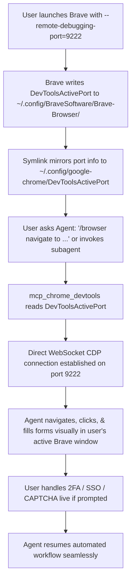

# Controlling Brave Browser in an Active Visual Window with Antigravity

This guide documents the exact mechanism used by Antigravity and its subagents to connect to, control, and automate an active **Brave Browser** instance on Linux (X11 / Wayland), allowing you to watch the agent perform actions live on your screen and intervene for logins, 2FA, or CAPTCHAs.

---

## 1. Core Architecture & Discovery Mechanism

Antigravity's browser automation capability (`browser` subagent type) uses the **Chrome DevTools Protocol (CDP)** through the internal `mcp_chrome_devtools` server.

### How Discovery Works
1. When a browser automation agent starts, the MCP server checks for an existing Chromium session before attempting to launch a new browser.
2. Under Linux, the MCP server looks for a discovery file named:
   ```text
   ~/.config/google-chrome/DevToolsActivePort
   ```
3. Inside this file, Chromium writes two lines:
   ```text
   <port_number>
   <browser_target_websocket_endpoint>
   ```
   *Example:*
   ```text
   9222
   /devtools/browser/88fd4a38-69c1-417c-9e3b-52ef75c26a58
   ```
4. By default, **Brave Browser** writes its own instance file to:
   ```text
   ~/.config/BraveSoftware/Brave-Browser/DevToolsActivePort
   ```
5. Because the MCP client hardcodes or defaults its path to Google Chrome's config directory, it does not check the Brave path natively.

---

## 2. The Bridge: Connecting the Agent to Brave

To route the DevTools MCP server directly into your open Brave session without modifying any binary or launching a hidden headless Chrome:

```bash
# Ensure the Google Chrome config directory exists
mkdir -p ~/.config/google-chrome

# Create a symbolic link pointing Chrome's DevToolsActivePort to Brave's
ln -sf ~/.config/BraveSoftware/Brave-Browser/DevToolsActivePort ~/.config/google-chrome/DevToolsActivePort
```

Once this symlink exists:
- Every time Brave is running with remote debugging enabled, it updates `~/.config/BraveSoftware/Brave-Browser/DevToolsActivePort`.
- Any Antigravity agent or subagent invoking browser tools (`mcp_chrome_devtools_navigate_page`, `click`, `fill`, `evaluate_script`, `take_screenshot`) immediately attaches to **your visible Brave browser tabs**.
- You see the cursor, form entries, page changes, and button clicks occurring live in your GUI.

---

## 3. How to Launch Brave for Automation

For Brave to generate `DevToolsActivePort` and listen for CDP connections, it must be launched with remote debugging enabled.

### Method A: Permanent Desktop Shortcut / Launcher (Recommended)
You can modify your Brave desktop launcher so that every time you open Brave, it is ready for agent pairing.

Edit `~/.local/share/applications/brave-browser.desktop` (or copy from `/usr/share/applications/brave-browser.desktop`):
```ini
Exec=/usr/bin/brave-browser-stable --remote-debugging-port=9222 %U
```

### Method B: Terminal Launch
If Brave is closed, launch it from the terminal:
```bash
brave-browser --remote-debugging-port=9222 &
# or if installed as brave:
/opt/brave.com/brave/brave --remote-debugging-port=9222 &
```

> [!NOTE]
> When Brave starts with `--remote-debugging-port=9222`, Brave may show an infobar or notification on startup: *"Remote debugging is enabled"*. This is standard Chromium security behavior.

---

## 4. Operational Workflow for Live Co-Working



### Step-by-Step Interaction Pattern
1. **Launch Brave**: Start Brave with `--remote-debugging-port=9222`.
2. **One-time Setup Check**: Verify the symlink:
   ```bash
   ls -l ~/.config/google-chrome/DevToolsActivePort
   ```
   It should point to:
   ```text
   ~/.config/google-chrome/DevToolsActivePort -> ~/.config/BraveSoftware/Brave-Browser/DevToolsActivePort
   ```
3. **Session Sharing (Authentication & 2FA)**:
   - When the agent navigates to a site (e.g. Amazon Seller Central) that requires a master login or 2FA, the agent pauses.
   - You switch to that tab in Brave, log in, approve the OTP/authenticator on your phone.
   - You reply *"logged in"* or *"proceed"*.
   - The agent reads the authenticated DOM immediately without needing to store or handle your raw account credentials.

---

## 5. Troubleshooting & Health Checks

If an agent reports it cannot connect to the browser or launches a new blank Chrome instance instead:

1. **Check if Brave is listening on port 9222**:
   ```bash
   ss -tulpn | grep 9222
   ```
2. **Check the DevToolsActivePort contents**:
   ```bash
   cat ~/.config/google-chrome/DevToolsActivePort
   ```
   You should see:
   ```text
   9222
   /devtools/browser/<guid>
   ```
3. **Verify the JSON version endpoint**:
   ```bash
   curl -s http://127.0.0.1:9222/json/version
   ```
   If curl returns JSON containing `"Browser": "Chrome/..."` or `"Brave"`, the DevTools server is active and accessible.

4. **Stale Lock or Crashed Session**:
   If Brave crashed previously and left a stale `DevToolsActivePort` with a dead port, restart Brave with `--remote-debugging-port=9222` to refresh the port file.

---

## 6. Prompting Future Agents to Use Brave

When instructing future agents, you can simply use this prompt pattern:

> *"Use my active Brave browser. Brave is running with remote debugging on port 9222, and ~/.config/google-chrome/DevToolsActivePort is symlinked to Brave's DevToolsActivePort. Connect to my existing session rather than starting a new headless browser."*
